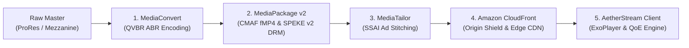

# AetherStream: End-to-End OTT Architecture & Senior Video Engineering Masterclass

---

## Table of Contents
1. [Module 1: The Foundations of OTT Streaming (Beginner to Intermediate)](#module-1-the-foundations-of-ott-streaming)
   - What is OTT (Over-The-Top)?
   - Containers vs. Codecs (The Core Mechanics)
   - Why Progressive MP4 Fails and Why Adaptive Bitrate (ABR) Exists
   - The Lifecycle of a Video Stream: From Cloud Ingest to Client Pixels
2. [Module 2: AetherStream Codebase Architecture & Implementation Deep-Dive](#module-2-aetherstream-codebase-architecture)
   - Feature-First Clean Architecture & BLoC State Management
   - The Native Video Playback Engine (ExoPlayer, Skia vs. Impeller, 60 FPS Hardware Decoding)
   - AWS Media Services Cloud Pipeline (MediaConvert, MediaPackage v2, MediaTailor SSAI, CloudFront CDN)
   - Video QoE & QoS Telemetry Engine (ITU-T P.1203, TTFF, Buffer Health)
   - Resumable Offline Download & Sync Engine (HTTP 206 Range, Offline Outbox, Crash Recovery)
   - Adaptive Multi-Screen UI & Design System
   - Automated GitHub Actions CI/CD Pipeline
3. [Module 3: Project-Specific Senior Technical Q&A](#module-3-project-specific-senior-technical-qa)
4. [Module 4: Extended Real-World Video Engineering & Industry Q&A](#module-4-extended-real-world-video-engineering-qa)

---

## Module 1: The Foundations of OTT Streaming

### 1.1 What is OTT (Over-The-Top)?
Traditionally, television and movies entered households through dedicated hardware cables, satellite dishes, or over-the-air broadcast antennas controlled by telecom and cable operators (e.g., Comcast, DirecTV, Tata Play).

**OTT ("Over-The-Top")** bypasses all specialized broadcast infrastructure. Content travels "over the top" of the open, unmanaged public internet directly to consumer IP devices (smartphones, tablets, smart TVs, PCs, game consoles) without the internet provider controlling the media distribution.

### 1.2 Containers vs. Codecs (The Core Mechanics)
To understand video streaming, you must separate the **Codec** from the **Container**:

```
+---------------------------------------------------------------+
| Container (.mp4, .mkv, .ts, .m4s)                            |
|  +---------------------------+  +---------------------------+  |
|  | Video Track: H.264 / HEVC |  | Audio Track: AAC / E-AC-3 |  |
|  +---------------------------+  +---------------------------+  |
|  +---------------------------+  +---------------------------+  |
|  | Subtitles: WebVTT         |  | Timestamps & Metadata    |  |
|  +---------------------------+  +---------------------------+  |
+---------------------------------------------------------------+
```

* **Codec (Coder-Decoder)**: The algorithm that compresses raw video frames into small digital data and uncompresses them during playback.
  * *Raw 4K video*: 3840×2160 pixels × 3 bytes per pixel × 60 frames per second $\approx$ **1.49 Gigabytes per second** (unstreamable!).
  * *Compressed 4K (HEVC/H.265)*: Compresses that same raw stream down to **15 Megabits per second** (a 700:1 compression ratio) by removing duplicate visual details between consecutive frames.
* **Container**: The file wrapper holding the video stream, audio tracks in various languages, subtitles, and synchronization timecodes together.

### 1.3 Why Progressive MP4 Fails for OTT Platforms
In early web design, a website hosted a single `.mp4` file. When a user clicked play, the browser downloaded the file progressively. 

**Why this fails for production streaming:**
1. **Network Fluctuations**: If a mobile user drives into a tunnel or cellular signal drops from 50 Mbps to 2 Mbps, a static 1080p MP4 file cannot shrink. The video halts, freezes, and enters an endless buffer wheel.
2. **Device Fragmentation**: An iPhone requires different audio/video formats than an Android phone, Smart TV, or Safari browser.
3. **Bandwidth Waste**: If a user watches only 2 minutes of a 2-hour movie and leaves, progressive download has already pre-fetched 500 MB of video data that the provider pays CDN egress fees for, and the user pays mobile data for.
4. **Piracy & Ad Blockers**: Plain MP4s are trivially downloaded via browser inspection and cannot cleanly splice user-targeted ads mid-stream.

### 1.4 Adaptive Bitrate Streaming (ABR: HLS & MPEG-DASH)
Modern OTT platforms solve this using **Adaptive Bitrate Streaming (ABR)**:
- Instead of one big file, the video is sliced into small, standalone chunks (e.g., **2.0-second fMP4 segments**).
- The video is encoded at multiple resolutions and bitrates simultaneously (called an **ABR Ladder**).
- A **Manifest file** (`.m3u8` for Apple HLS, `.mpd` for MPEG-DASH) acts as a live index listing all chunks and quality rungs.
- The client player (ExoPlayer/AVPlayer) measures the device's download speed every second and dynamically switches quality rungs mid-playback without stalling!

```
[Master Manifest (.m3u8 / .mpd)]
       |
       +---> 2160p (15.8 Mbps) -> [Seg0.m4s] [Seg1.m4s] [Seg2.m4s] (High Wi-Fi / 5G)
       +---> 1080p (6.4 Mbps)  -> [Seg0.m4s] [Seg1.m4s] [Seg2.m4s] (Standard 4G)
       +---> 720p  (3.2 Mbps)  -> [Seg0.m4s] [Seg1.m4s] [Seg2.m4s] (Congested Signal)
       +---> 480p  (1.25 Mbps) -> [Seg0.m4s] [Seg1.m4s] [Seg2.m4s] (Emergency Floor)
```

---

## Module 2: AetherStream Codebase Architecture & Implementation

### 2.1 Feature-First Clean Architecture & BLoC State Management
The project follows **Clean Architecture** organized by features, isolating business logic from UI rendering:

```
lib/
├── app/                  # Application root, theme (AetherTheme), and global providers
├── core/                 # Shared domain utilities, storage, network probing, video factory
│   ├── bloc/             # Global BlocObserver for logging state transitions
│   ├── media/            # Platform-specific VideoPlayerController factories
│   ├── network/          # TCP socket reachability prober & connectivity monitor
│   └── storage/          # AetherPersistenceService (SharedPreferences wrapper)
├── features/             # Modular feature slices:
│   ├── catalog/          # Discovery feed, categories, media models, repository
│   ├── player/           # ExoPlayer view, scrubbers, Stats for Nerds, X-Ray, Mini-Player
│   ├── analytics/        # Real-time ITU-T P.1203 QoE scoring & bitrate charting
│   ├── aws_media/        # AWS Elemental Pipeline Lab, SPEKE DRM, SSAI, manifest inspector
│   ├── watchlist/        # Bookmark manager & resumable chunked offline CMAF downloader
│   └── profile/          # User profile sync, Offline Outbox, device management
└── shared/               # AdaptiveShellScaffold, MiniPlayerDock, MediaPosterCard
```

#### Independent BLoCs & Cubits:
1. **`CatalogBloc`**: Manages media catalog hydration, instant filtering, and metadata.
2. **`PlayerBloc`**: Manages playback lifecycle, ABR variant selection, subtitle streams, X-Ray intelligence, and dockable Mini-Player state.
3. **`TelemetryBloc`**: Samples playback metrics every 500ms, calculates ITU-T P.1203 QoE scores, buffer health, dropped frames, and emits telemetry beacons.
4. **`AwsPipelineCubit`**: Simulates the 5 cloud stages, dynamically renders HLS/DASH manifests, and toggles SPEKE v2 DRM and MediaTailor SSAI.
5. **`WatchlistCubit`**: Handles bookmarking and progressive chunked offline downloads using simulated HTTP 206 Range requests.
6. **`ProfileSyncBloc`**: Manages guest-to-user state preservation, offline playback checkpointing, and the **Offline Outbox**.

---

### 2.2 The Native Video Playback Engine (Achieving Stable 60 FPS)

#### Root Causes of Player Stuttering and How They Were Solved:
1. **The Impeller Surface Fence Bug on Android < 33**:
   - Flutter's new Impeller graphics backend on Android uses `ImageReaderSurfaceProducer`. On physical Android 12/API 31 devices (e.g., Samsung SM-M215F), ExoPlayer's hardware surface buffer cannot safely synchronize with Impeller's Vulkan fence, triggering continuous logcat errors:  
     `ImageReaderSurfaceProducer: ImageTextureEntry can't wait on the fence on Android < 33`.
   - **Fix**: Disabled Impeller in [`android/app/src/main/AndroidManifest.xml`](file:///d:/growth/ott_app/android/app/src/main/AndroidManifest.xml#L31-L34) using `<meta-data android:name="io.flutter.embedding.android.EnableImpeller" android:value="false" />`. This switches the rasterizer to Skia, which binds ExoPlayer's hardware texture directly to OpenGL without fence deadlock.

2. **Offscreen GPU `saveLayer` Stalls**:
   - Wrapping player controls in an `AnimatedOpacity` that animates between 0.0 and 1.0 caused Skia to call `SkCanvas::saveLayer()` across the entire 1080p/4K frame on every frame tick, allocating an offscreen framebuffer that choked the GPU.
   - **Fix**: Replaced `AnimatedOpacity` with `Visibility(maintainState: true)` and replaced full-screen darkening overlays with localized 60px top and 68px bottom scrims in [`aether_video_player_view.dart`](file:///d:/growth/ott_app/lib/features/player/presentation/widgets/aether_video_player_view.dart#L685-L735).

3. **60 Hz Video Progress Rebuild Decoupling**:
   - A typical video scrubber rebuilds its parent widget tree 60 times a second whenever the playhead advances.
   - **Fix**: Implemented `_YouTubeVideoProgressScrubber` using an isolated `CustomPainter` (`_YouTubeScrubberPainter`) driven by an internal 500ms `ValueNotifier<double>` and real-time touch gestures. The video timeline scrubber updates its canvas without triggering Flutter widget builds, keeping UI CPU load near 0%.

---

### 2.3 The AWS Media Services Cloud Pipeline



1. **AWS Elemental MediaConvert**:
   - File-based transcoding from raw video masters into a multi-rendition ABR ladder.
   - Uses **QVBR (Quality-Defined Variable Bitrate Level 9)** to allocate bits where motion is high and conserve bits during static scenes.
   - Enforces a strictly locked **2.0-second closed Group-of-Pictures (GOP = 48 frames at 24fps)**, ensuring that I-frames across 4K, 1080p, 720p, and 480p align down to the millisecond.

2. **AWS Elemental MediaPackage v2**:
   - **Just-In-Time Packaging (JITP)**: Holds a single set of CMAF fMP4 chunks in Amazon S3 and serves both Apple HLS (`.m3u8`) and MPEG-DASH (`.mpd`) on demand.
   - **SPEKE v2.0 (Secure Packager and Encoder Key Exchange)**: Interfaces with DRM key providers to encrypt video chunks using:
     - **Google Widevine Modular (L1/L3)** via Common Encryption (CENC `cenc:default_KID`).
     - **Apple FairPlay Streaming** via Sample-AES CBCS encryption.

3. **AWS Elemental MediaTailor (Server-Side Ad Insertion - SSAI)**:
   - Watches for **SCTE-35 splice markers** in the video stream.
   - Queries an Ad Decision Server (ADS) via **VAST 4.2 / VMAP**.
   - Transcodes the returned ad to match the stream's exact ABR specifications and stitches the ad segments directly into the manifest.
   - Client players stream the ad as part of the movie, making it 100% immune to ad-blockers and eliminating client-side buffering between movie and ad pods.

4. **Amazon CloudFront + Origin Shield**:
   - Edge distribution across 600+ Global Points of Presence (PoPs) using HTTP/3 QUIC.
   - **Origin Shield**: Consolidates regional cache fills so thousands of simultaneous viewers only hit the packaging origin once.
   - **Signed URLs / Cookies**: Enforces short-lived RSA/ECDSA cryptographic tokens on manifest playlists to prevent stream piracy.

---

### 2.4 Video QoE & QoS Telemetry Engine

In [`telemetry_bloc.dart`](file:///d:/growth/ott_app/lib/features/analytics/presentation/bloc/telemetry_bloc.dart), the app calculates real-time streaming health:
* **Time-to-First-Frame (TTFF)**: Measures the latency (ms) from initial user click to the first decoded video frame.
* **Buffer Health**: Tracks the forward audio/video CMAF seconds in memory (healthy target: > 14 seconds).
* **ITU-T P.1203 QoE Score**: Computes an algorithmic score (1.0 to 5.0) measuring subjective user satisfaction factoring in resolution switches, rebuffering duration, and compression quality.
* **Network Condition Simulator**: Allows users/recruiters to throttle network speed between Fiber (25 Mbps), LTE (8.5 Mbps), Congested 4G (3.8 Mbps), and 3G (1.6 Mbps) to watch the ABR engine step down its rendition ladder in real time.

---

### 2.5 Resumable Offline Download & Sync Engine

#### Offline Outbox Pattern:
When the app is offline, all state changes (playback checkpoints, completed watch times) are pushed to the **SyncOutbox** with `isSynced: false` in [`profile_sync_bloc.dart`](file:///d:/growth/ott_app/lib/features/profile/presentation/bloc/profile_sync_bloc.dart#L485-L515). When the phone reconnects to internet:
1. `ProfileConnectivityToggled(true)` triggers a flush.
2. Checkpoints are synchronized to the cloud in a single transactional batch.
3. Entries flip to `isSynced: true`.

#### Preserving Playhead Across App Restarts Without Internet:
1. During playback, every 60 ticks (and during Android activity pause/detach lifecycle events in `AdaptiveShellScaffold`), the playhead integer seconds (e.g., `124s`) are written to local persistent storage (`AetherPersistenceService`).
2. When the phone boots with internet turned off, `ProfileSyncBloc` hydrates from disk in **Offline Mode**.
3. When the user taps the downloaded video in the Profile tab, `AetherVideoPlayerView` reads `effectiveResumeFor(mediaId)`.
4. ExoPlayer executes `ctrl.seekTo(124s)` and resumes playback from the local CMAF storage without requiring internet connection.

---

## Module 3: Project-Specific Senior Technical Q&A

### Q1: Why did video playback stutter periodically every second or 4 seconds before the fix?
**Answer**:  
There were two distinct root causes:
1. **Premature Resume Seeking**: The video player had logic checking `if (resume >= 3s)` on launch. When previously watched for just 1s or 4s, it triggered `ctrl.seekTo()`. In video codecs, seeking causes the hardware decoder to perform an `ACodec signalFlush`, dropping all decoded B-frames and seeking to the nearest **Group of Pictures (GOP) I-frame**. Short clips had 1s GOPs; 1080p master clips had 4s GOPs.
2. **Background Network Prewarming**: On launch, the discovery shell ran an unthrottled loop calling `prewarmVideoStreamCache` for all 9 catalog items simultaneously on the Dart event loop, flooding the network and starving ExoPlayer’s HTTP thread pool.

### Q2: Why did you disable Impeller on Android in `AndroidManifest.xml`?
**Answer**:  
Flutter's Impeller backend on Android uses `ImageReaderSurfaceProducer` to render video textures. On Android versions below 33 (e.g., Android 12 / API 31), there is an upstream driver issue where hardware sync fences cannot wait across Vulkan-OpenGL texture boundaries, causing logcat spam: `ImageTextureEntry can't wait on the fence on Android < 33` and frame stutter. Disabling Impeller with `<meta-data android:name="io.flutter.embedding.android.EnableImpeller" android:value="false" />` falls back to Skia, which renders hardware video textures directly at a stable 60 FPS.

### Q3: How did you fix the progress bar causing frame drops when visible?
**Answer**:  
We decoupled the transport scrubber from the widget tree:
1. Replaced the 60 Hz full-widget rebuilds with an isolated `_YouTubeVideoProgressScrubber` driven by a `ValueNotifier<double>` ticking at 500ms and real-time touch scrub gestures.
2. Isolated the timecode display into a dedicated `_LiveTimecodeText` widget so that counting seconds does not trigger repaints of transport buttons.
3. Replaced `AnimatedOpacity` with `Visibility(maintainState: true)` to avoid Skia offscreen `saveLayer` GPU framebuffer allocations.

### Q4: When a user downloads a video offline and taps the button again, what happens?
**Answer**:  
Previously, `toggleOfflineDownload` removed the asset from state, causing the user to re-download.  
We updated `player_studio_page.dart` so that when `isCompleted == true`:
- Tapping does **not** re-download or delete.
- It displays a floating SnackBar: *"Offline video is available under Profile section"* with an action button *"View in Profile"* that switches directly to tab index 4.
- Long-pressing opens a bottom sheet allowing the user to either navigate to the offline library or explicitly delete the download to free disk space.

### Q5: How do you handle Guest-to-User account transition without resetting watch history?
**Answer**:  
In [`profile_sync_bloc.dart`](file:///d:/growth/ott_app/lib/features/profile/presentation/bloc/profile_sync_bloc.dart#L350-L400), when `ProfileSignInRequested` is triggered, the BLoC executes `_mergeGuestProgressIntoProfile`:
- It reads the guest resume dictionary (`guestResumeSeconds`) and merges any higher timestamps into the signed-in user's `profileResumeSeconds`.
- The current video's playhead position is preserved and emitted in the new state, so the viewer does not experience any jump or reset to 0:00.

### Q6: What is CMAF and why is it used instead of legacy MPEG-2 TS?
**Answer**:  
Legacy streaming used MPEG-2 Transport Streams (`.ts` files) for HLS, and fragmented MP4 (`.mp4`) for DASH. This forced OTT platforms to store two duplicate copies of the same video in cloud storage.  
**CMAF (Common Media Application Format)** standardizes video chunks into unified fragmented MP4 (`.m4s` / `fMP4`). A single set of files on AWS S3 can be referenced by both an Apple HLS manifest (`.m3u8`) and an MPEG-DASH manifest (`.mpd`), cutting cloud storage and CDN caching costs by 50%.

---

## Module 4: Extended Real-World Video Engineering & Industry Q&A

### Q1: What is the difference between Low-Latency HLS (LL-HLS) and WebRTC for live sports streaming?
**Answer**:  
* **WebRTC**: Operates over UDP and achieves ultra-low latency (< 500ms). However, it does not scale well to millions of concurrent viewers because it requires server-side stateful media relay nodes (SFUs), making CDN edge caching impossible and skyrocketing server costs.
* **LL-HLS**: Achieves 1.5 to 3.0 seconds latency by using CMAF chunked transfer encoding (delivering sub-second chunk parts via HTTP Chunked Transfer before the full 2s segment is finished). Because it runs over standard HTTP/3 CDN caches (CloudFront, Akamai), it easily scales to 50+ million concurrent users during events like the FIFA World Cup or Super Bowl.

### Q2: What is the difference between Widevine L1, L2, and L3 DRM on Android?
**Answer**:  
* **Widevine L1**: Cryptography and video decoding happen entirely inside the device’s **Hardware Trusted Execution Environment (TEE)** or Secure Processing Unit. Raw decrypted video frames are never exposed to Android user space or RAM. Hollywood studios require L1 for 1080p and 4K playback.
* **Widevine L2**: Crypto runs in hardware, but video decoding happens in software. (Rarely used).
* **Widevine L3**: All crypto and decoding happen in software. Vulnerable to memory dumping and screen recording. Streaming platforms restrict L3 devices to standard definition (SD 480p or 540p).

### Q3: Why is Server-Side Ad Insertion (SSAI) preferred over Client-Side Ad Insertion (CSAI) in enterprise OTT?
**Answer**:  
* **CSAI (Client-Side)**: The mobile app pauses the video player, calls an ad SDK (like Google IMA), loads a separate ad player, plays the ad, and then switches back to the movie. This is vulnerable to ad blockers, causes visible black-screen flashes, and frequently causes buffer underruns.
* **SSAI (Server-Side with AWS MediaTailor)**: The ad is spliced directly into the HLS/DASH manifest stream on the server. The player perceives the ad as normal movie chunks. It offers zero buffer pause, seamless bitrate transitions, and 100% ad-blocker immunity.

### Q4: What is the difference between Constant Bitrate (CBR), Variable Bitrate (VBR), and Quality-Defined Variable Bitrate (QVBR)?
**Answer**:  
* **CBR**: Uses the exact same number of bits per second regardless of content. Wastes massive bandwidth on simple talking-head scenes, and looks pixelated during high-motion action scenes.
* **VBR**: Adjusts bits based on complexity, but requires 2 passes and can spike unpredictably.
* **QVBR (Used in AWS MediaConvert)**: Sets a target visual quality level (e.g., Level 9 on a 1-10 scale). The encoder uses only the bits needed to achieve that visual score. If a scene is static, it drops bitrate drastically; if confetti or water explosions occur, it raises bitrate up to the defined ceiling. This saves 20–40% CDN egress costs without human inspection.

### Q5: How do multi-CDN architectures handle CDN failures during major live events?
**Answer**:  
Enterprises (e.g., Netflix, Prime Video) deploy **Multi-CDN Steering**:
1. Client-side SDKs embed a real-time probe reporting segment download latency, HTTP 5xx errors, and throughput to a telemetry service (e.g., Conviva, Datadog).
2. A dynamic manifest manipulation service (or DNS / Anycast load balancer) switches subsequent segment URLs from CDN A (e.g., CloudFront) to CDN B (e.g., Akamai or Fastly) mid-stream within 2 seconds if error rates spike.

### Q6: What are SCTE-35 markers and how do they function?
**Answer**:  
**SCTE-35** is the broadcast standard protocol for signaling commercial insertion cues in transport streams. A broadcast playout automation system inserts binary SCTE-35 splice tags into the video timeline (e.g., `SCTE35-OUT` indicating an ad break begins in 5 seconds and lasts for 30 seconds). AWS MediaLive and MediaTailor read these markers and execute frame-accurate ad splices.

### Q7: Why is Closed GOP alignment mandatory for Adaptive Bitrate Streaming?
**Answer**:  
In video compression, a **GOP (Group of Pictures)** begins with an **I-frame (Intra-frame / Keyframe)** containing full image data, followed by P-frames and B-frames referencing the I-frame.  
A **Closed GOP** means no frame inside the GOP references any frame outside it.  
If GOPs are not aligned across all rungs (e.g., 4K, 1080p, 720p) at the exact same frame numbers (e.g., every 48 frames), switching quality mid-stream causes the hardware decoder to crash or glitch because it references a predictive motion vector from a non-existent frame size.
